# Marine Layer

**A foggy San Francisco neighbourhood at dawn: a backyard garden growing from seedling to harvest, the Excelsior's streets around it and McLaren Park up the hill, right in your browser.**

Cream-painted raised beds in red lava rock, staked tomato vines heavy with dark heirloom fruit, zucchini, potted blueberries, herbs, drip lines, a paved patio, a deck off the back of a yellow house, a worm bin, and a cat on the fence watching you. The fog rolls through and thins as the sun comes up. Everything is made by code: no images, no 3D models, no sound files, in **one 166 kB HTML file**.

Then fly out over the fence. The garden is one lot of a block of row houses built into the hill: two storeys from the street, garage below, while the back yards lie a storey up, level with the living floor, behind one-storey additions that jut into them; around it are more blocks, back yards, street trees, parked cars, cars and buses driving the streets and stopping at every four-way stop. East of the houses the hills rise into the park: eucalyptus, cypress and pine groves, meadows crossed by trails, a pond, and the blue water tank on the hilltop.

**[Try it in your browser →](https://dcmonger.github.io/abyssal-garden/)** (needs WebGPU: a recent Chrome or Edge works best)

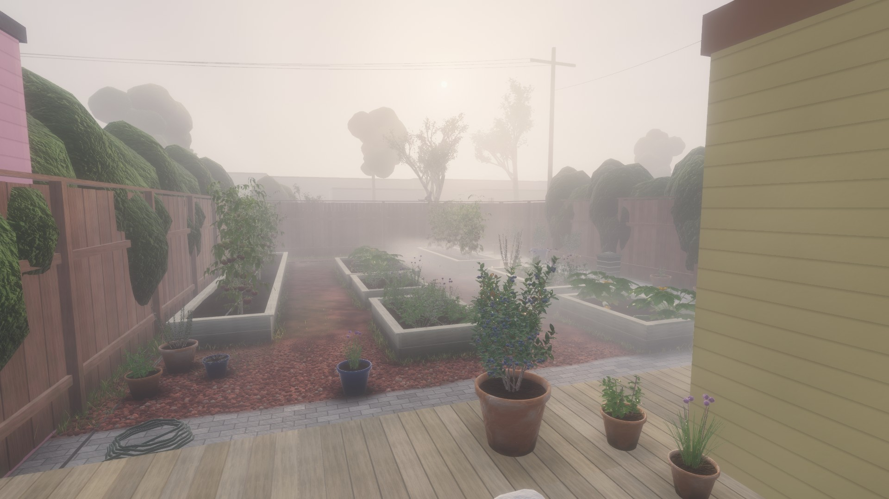

It is built on the engine of [Abyssal Garden](https://github.com/Noniv/abyssal-garden) by Noniv: the same WebGPU renderer, detail levels, controls and build pipeline, with a new world, new shaders and new sound.

## Try it

1. Download [`index.html`](index.html).
2. Open it in **Chrome** or **Edge** on a desktop computer.
3. Wait a moment while the neighbourhood is built, then press **Step outside**.

Nothing to install, and it works offline. It needs a browser with **WebGPU**.

## What's out there

- **Dawn that happens while you watch:** over about three minutes the sun clears the back fence, the porch lamp goes out, the fog thins and light shafts come through the lattice and the tree behind it. Later, banks of fog roll back in.
- **A time-lapse of the season:** scroll the mouse wheel (or drag the slider) and the plants grow from seedlings: vines climb their stakes, flowers open and drop, fruit sets, swells and ripens.
- **Dew:** beads on leaves and fruit that sparkle once the sun reaches them, and a spider's web in the corner of the fence.
- **The house, inside:** walk in at the back door or up the front steps. The two floors are built from the house's real floor plans: on the main floor, level with the garden, the kitchen with its cherry cabinets and island, the dining room, the living room with its brick fireplace and bay window, two bedrooms, two baths; down the stairs, a bedroom with a window onto a well under the deck, a den and bar, a bath, the laundry and the garage, dug into the hill under it all. The lamps are on, pooling warm light in each room, and the dawn comes in through glass that catches the sky.
- **The neighbourhood:** about 1.3 km by 0.9 km of it: about 2,400 two-storey row houses on deep 34-foot lots, garage below and living floor above, with flat roofs mostly and an addition out the back of most; mostly in muted paint with the odd purple, pink or yellow one the Excelsior is known for. Some windows are lit before dawn. Every house has its back yard behind it, a storey above the street, held up by a retaining wall where the block ends, against the yard of a house facing the next street: lawns, patios and decks, hedges over the fences, picnic tables, grills and umbrellas, sheds, trees, lamp posts and strings of bulbs that glow until the sun is up. Parked cars line the kerbs; cars and trolley buses drive the streets and pull up at each four-way stop, headlights on in the fog.
- **McLaren Park:** the hills east of the houses, with groves of eucalyptus, Monterey cypress and pine, open meadows and dirt trails, a pond and the water tank on the summit. A certain three-pronged tower stands on the far ridge when the fog lets you see it.
- **Sound made up as you listen:** a soft wind, slow warm chords, now and then a foghorn far off, a dawn chorus that fills in as it gets light, and the neighbourhood waking up: a far hum of traffic, cars swishing by, a bus sighing to a stop.

| | |
|---|---|
| 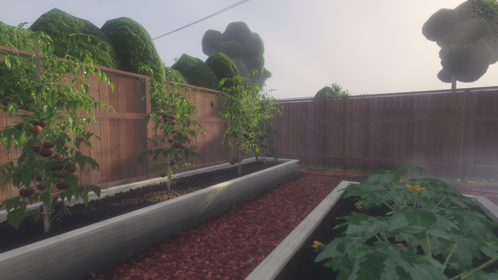 | 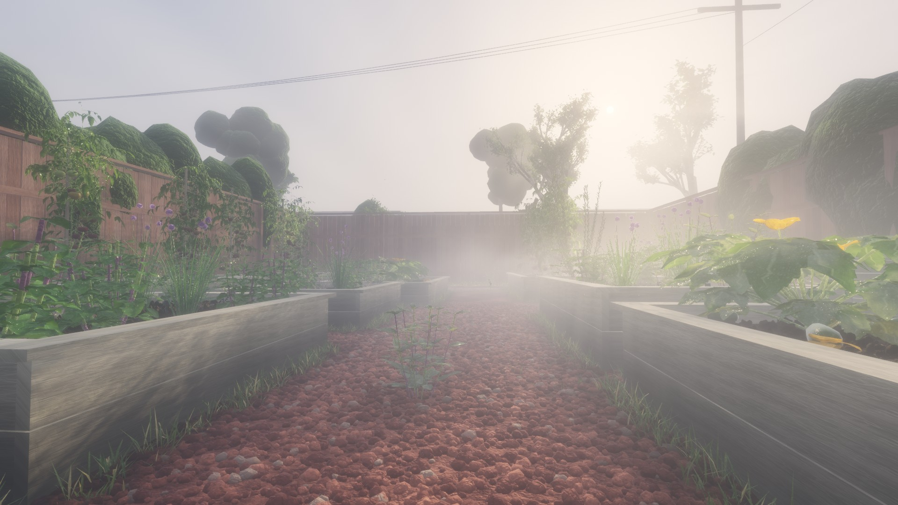 |
| 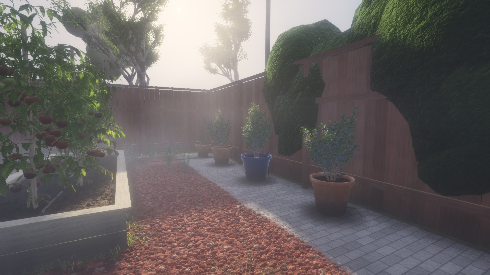 | 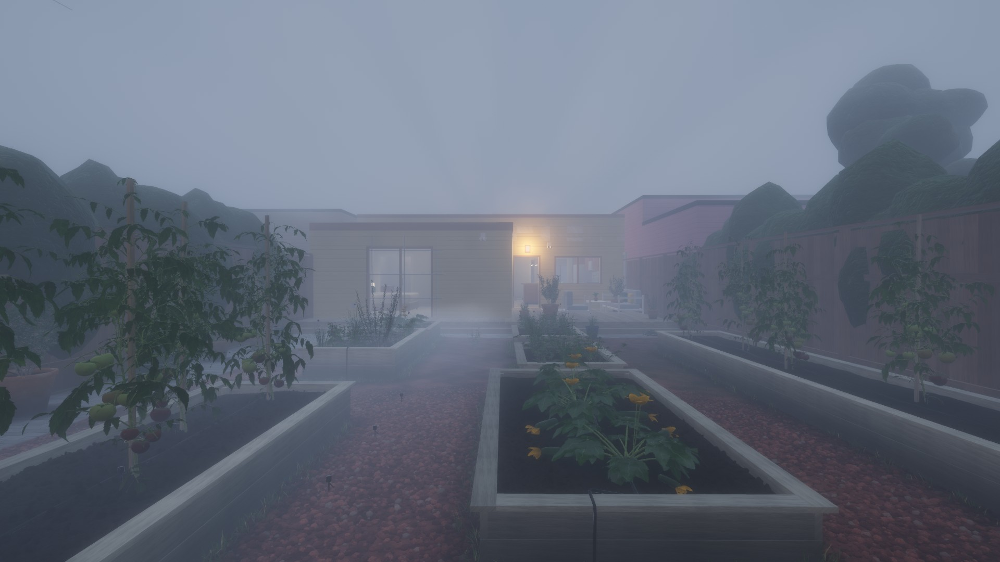 |

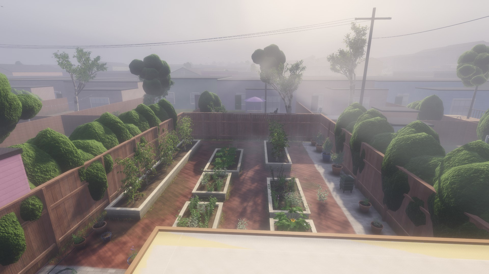

| | |
|---|---|
| 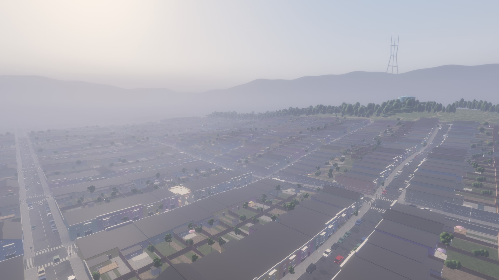 | 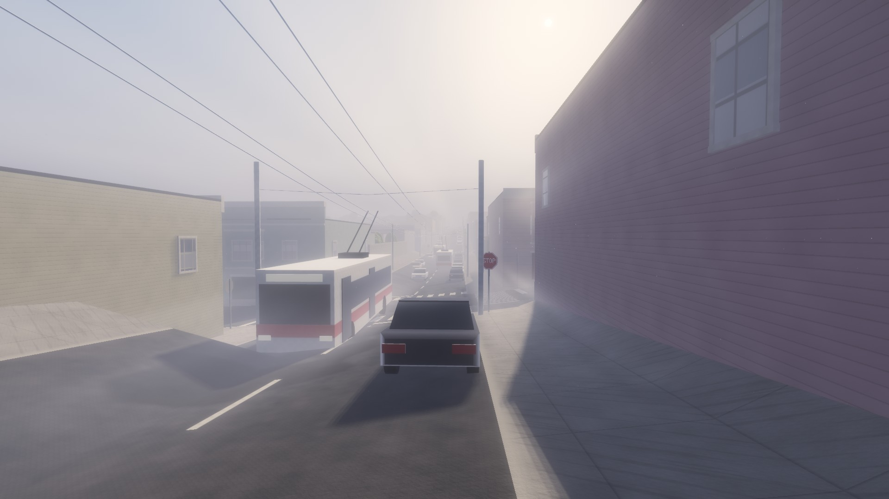 |
| 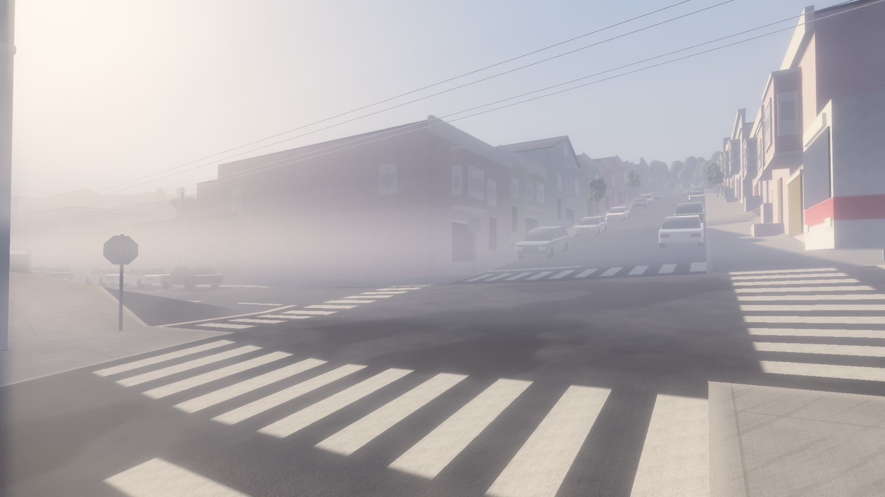 | 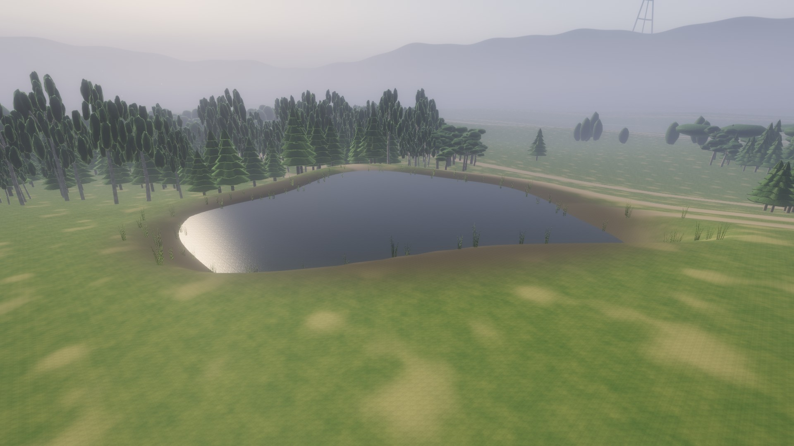 |
| 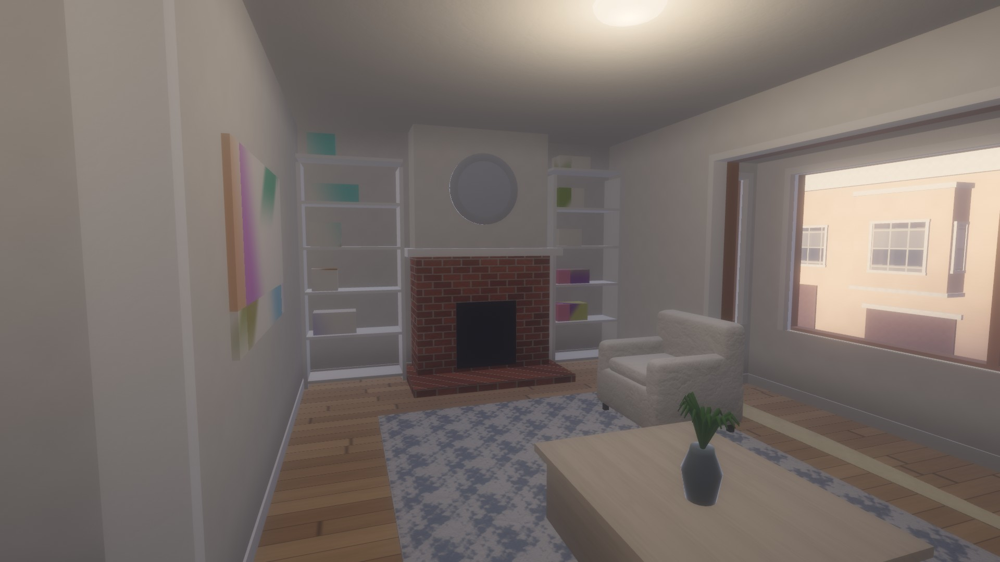 | 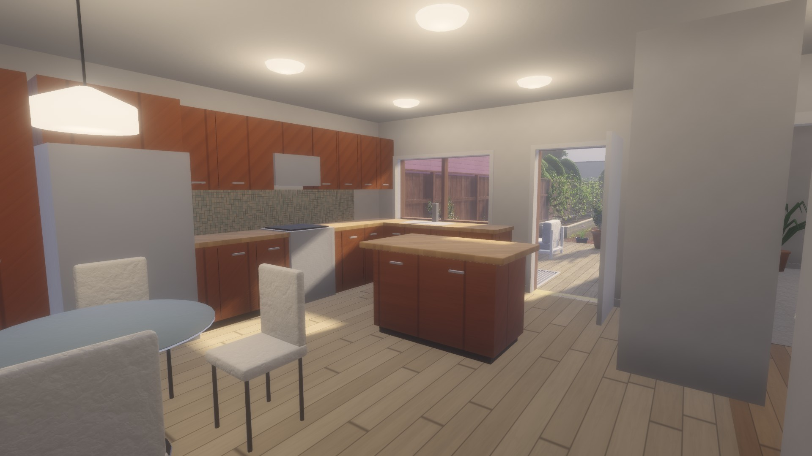 |

## Controls

| | Keyboard & mouse |
|---|---|
| Look around | Move the mouse |
| Move | `W` `A` `S` `D` |
| Up / down | `E` / `Q` |
| Move faster | Hold `Shift`. The higher you fly, the faster you go, so the neighbourhood can be crossed in a few seconds from the air |
| Jump to a viewpoint | `1` to `6` in the garden, `7` the street out front, `8` over the rooftops, `9` the park's hilltop, `0` inside the house |
| Season (seedling → harvest) | Mouse wheel, or `←` `→`; the slider at the bottom shows where you are |
| Play the time-lapse | `T` |
| Menu | `Esc` releases the mouse and opens the menu with the list of controls; **Resume** takes you back |
| Sound on / off | `M` (sound starts when you dive in) |
| Performance stats | `H` |
| Detail level | **Low**, **Medium** or **High** in the menu (reloads the page) |

You can fly anywhere in the neighbourhood and the park, and through the garden's house: its doors are open, its floors and walls hold you, and you can fly down the stairs. Other houses stop you: fly up to a wall and you halt there, or slide along it; above the roofline you fly over them. You rise gently over the beds, the pots and the worm bin; plants, trees and cars you pass through.

**On a touchscreen:** hold one finger down to move forward and slide it to steer. Put a second finger down to go faster. Drag the slider to grow the garden. The `≡` button in the corner opens the menu. Phones always show the scene in landscape and start on Low or Medium detail. (Touch support is experimental.)

## Detail levels

The **Low**, **Medium** and **High** buttons in the menu pick the detail level; the current one is lit. Each level is the same world, built with less in it:

| Level | What it is | Picked on a first visit for |
|---|---|---|
| **High** | The full scene | Computers |
| **Medium** | Half of the grass, needles, tree leaves and mulch chips; a smaller shadow map | Phones with 8 GB of memory |
| **Low** | A quarter of them, no anti-aliasing, coarser meshes, simpler shadows, fewer steps through the fog, 480p to start with | Other phones, and computers with 4 GB of memory or less |

If loading crashes the tab, or the graphics driver gives up, the page starts again one level lower. Your browser remembers the level, and the resolution and draw distance the scene settled on, for the next visit.

## How it works

- Every plant is grown by a small generator. Each stem piece, leaf, flower and fruit carries the moment in the season it appears and how long it takes to reach full size; the graphics card scales it from that, so the slider costs nothing.
- The fog is marched through at half resolution every frame, with a drifting 3-D noise for banks and wisps and the shadow map for light shafts. The shadow map is redrawn every frame, because the sun moves and the plants grow and sway.
- Everything is drawn with **WebGPU** directly. No game engine or 3D library is used. The sound is synthesized live with the Web Audio API.
- On slower hardware it aims for 60 fps by lowering first the resolution and then how far away small things are drawn.

## Make it your own

The readable source code is in the [`source`](source) folder. To change something and rebuild `index.html` you need [Node.js](https://nodejs.org) 18 or newer:

```bash
cd source
npm install
npm run build
```

`npm run build:readable` writes an unminified version. `npm run build:dev` writes a separate `dev.html` with extra tools: `F` flies the camera along a 90-second path through the yard and the neighbourhood, `B` runs that flight as a benchmark, and `window.cap({ pose, t, dawn, grow })` holds the scene still at a chosen moment for screenshots.

| File | What's inside |
|---|---|
| [`source/src/world.js`](source/src/world.js) | The yard layout and the generators: fences, beds, plants, the cat, houses, trees, fog noise. **A good place to start.** |
| [`source/src/shaders.js`](source/src/shaders.js) | The look: materials, leaves and dew, fog and light shafts, sky (WGSL shader code) |
| [`source/src/home.js`](source/src/home.js) | The garden's house, inside and out, transcribed from its floor plans, and the walls and floors that hold the camera in it |
| [`source/src/city.js`](source/src/city.js) | The neighbourhood: row houses, trees, cars, buses, stop signs, the park, and where they all go |
| [`source/src/main.js`](source/src/main.js) | The renderer, the dawn clock (`sky()`), the camera, the controls, the ten viewpoints and the camera path |
| [`source/src/audio.js`](source/src/audio.js) | Wind, foghorns and birds |
| [`source/src/quality.js`](source/src/quality.js) | The detail levels |
| [`source/src/math.js`](source/src/math.js) | Noise, random numbers and mesh-building helpers |
| [`source/src/dev.js`](source/src/dev.js) | Development tools, only in `dev.html` |
| [`source/template.html`](source/template.html) | The page around the scene: loading bar, start menu, slider and their styles |

Some easy first tweaks:

- **How long dawn takes:** `dt / 200` in `frame()` in `main.js`
- **Fog thickness and sunlight colour:** `sky()` in `main.js`
- **Where the beds and pots are:** `BEDS` and `POTS` at the top of `world.js`
- **The street grid, the park and the hills:** the lot width and count (`LOTW`, `NLOT`; the blocks follow from them) and `HT()` in `math.js` (the shaders have a copy of `HT` called `ht`)
- **Walking speed:** search for `5 : 1.7` in `main.js` (fast speed : normal speed)

## License

[MIT](LICENSE): free to use, change and share, including in your own projects.
